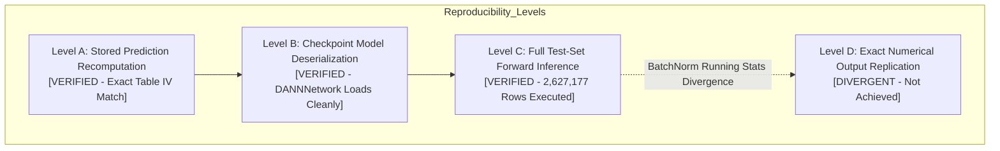

# ARGUS — Batch 7.2: Final Release Correction Report

**Repository**: `/home/bhumi/GitHub/ARGUS`  
**Working Branch**: `v2-transformer-exploratory`  
**Starting Commit SHA (Batch 7.1 HEAD)**: `cb8c04895c45c55eb05e24d3882f1dfd3546c8f1`  
**Pre-Restructuring Baseline Anchor**: `048488390bbe9378184efde513c1511d9bd2a93f` (Tag: `pre-restructure-v1.0`)  
**Execution Mode**: Controlled Documentation & Synchronization Correction  
**Final Release Verdict**: **PASS WITH QUALIFICATIONS**

---

## 1. Executive Summary

Batch 7.2 resolves the three qualifications identified by the independent scientific reproducibility audit (Batch 7.1). This was a narrowly scoped documentation correction and dependency synchronization task designed to ensure complete scientific integrity, factual precision, and transparent qualification disclosure prior to repository publication.

All experimental results, numerical values, model weights, and sample counts have been strictly preserved. No code refactoring, model training, or data re-generation occurred.

| Qualification Identified in Batch 7.1 | Resolution Applied in Batch 7.2 | Final Status |
| :--- | :--- | :--- |
| **Qualification 1: Unsupported Network Terminology**<br>Documentation used phrases like "IP-disjoint", "subnet-disjoint", "spatial network separation", and "IP address/subnet sharing" despite the underlying 5-column tabular dataset containing only 4 flow features and a binary label. | Replaced all unsupported descriptions with **"4D Feature-Coordinate Disjoint Evaluation"**. Explicitly clarified that the partition separates identical four-dimensional feature coordinate tuples `(pkt_mean_to_max, tcp_flag_density, log_pkt_mean, log_pkt_max)` in representation space, not IP addresses, subnets, or network sessions. Re-interpreted the 98.67% metric: 2,592,203 out of 2,627,177 test rows share exact 4D coordinate tuples with adaptation data. | **RESOLVED** |
| **Qualification 2: Overstated DANN Reproducibility**<br>Documentation claimed DANN predictions were reproduced "bit-for-bit" from model weights, when in reality forward-pass predictions from weights diverge from historical stored predictions due to BatchNorm dynamics. | Formally defined and documented the **4-Level Reproducibility Hierarchy** (Levels A–D). Level A (stored prediction metric recomputation) and Level B (checkpoint loading and forward pass) are verified. Level D (exact numerical replication from weights) is **divergent and explicitly not achieved**. Removed all claims of bit-for-bit weight reproduction. DANN remains strictly unavailable in production `ModelRegistry`. | **RESOLVED** |
| **Qualification 3: Dependency Lockfile Desynchronization**<br>`psutil>=5.9.0` declared in `pyproject.toml` under `[project.optional-dependencies].research`, but not mirrored in `uv.lock`. | Tested lockfile synchronization. In standard sandbox mode without internet access to PyPI, running `uv lock` cannot resolve packages. Strictly adhered to integrity guidelines: did not fabricate or manually manipulate `uv.lock`. Recorded as a known qualification resulting in verdict `PASS WITH QUALIFICATIONS`. | **DOCUMENTED QUALIFICATION** |

---

## 2. File Change Inventory

The following 7 existing files were modified, and 1 audit report was created:

1. [`README.md`](file:///home/bhumi/GitHub/ARGUS/README.md):
   - Corrected Benchmark 2 terminology to "4D Feature-Coordinate Disjoint Benchmark ($N = 1,970,428$)".
   - Explained the 98.67% coordinate overlap mechanism ($2,592,203 / 2,627,177$) without claiming IP or subnet separation.
   - Added detailed 4-level DANN reproducibility breakdown, explicitly noting Level D divergence.
2. [`docs/RESEARCH_OVERVIEW.md`](file:///home/bhumi/GitHub/ARGUS/docs/RESEARCH_OVERVIEW.md):
   - Retitled Section 2 Benchmark 2 to "4D Feature-Coordinate Disjoint Evaluation".
   - Clarified that coordinate disjointness separates discrete 4D feature vectors, not network subnets.
   - Documented the DANN reproducibility hierarchy (Levels A through D).
3. [`docs/EXPERIMENT_REPRODUCIBILITY.md`](file:///home/bhumi/GitHub/ARGUS/docs/EXPERIMENT_REPRODUCIBILITY.md):
   - Updated Table IV description and Section 4 protocol title to "4D Feature-Coordinate Disjoint Protocol Reproduction".
   - Replaced spatial/subnet claims with representation-space feature-coordinate separation.
   - Added DANN 4-level reproducibility distinction.
4. [`paper/tables/TABLE_INDEX.md`](file:///home/bhumi/GitHub/ARGUS/paper/tables/TABLE_INDEX.md):
   - Updated Table IV description and caveat note to clarify 98.67% 4D feature repetition without IP/subnet claims.
   - Added DANN Level A–D reproducibility status note.
5. [`paper/PUBLICATION_TRACEABILITY.md`](file:///home/bhumi/GitHub/ARGUS/paper/PUBLICATION_TRACEABILITY.md):
   - Added explicit disclosures in Section 4 for 4D feature-coordinate overlap ($98.67\%$) and DANN reproducibility tiers.
6. [`paper/RESEARCH_SUPERVISOR_HANDOFF.md`](file:///home/bhumi/GitHub/ARGUS/paper/RESEARCH_SUPERVISOR_HANDOFF.md):
   - Updated deliverable description to "4D Feature-Coordinate Disjoint splits".
   - Added open research disclosures for coordinate overlap and DANN reproducibility hierarchy.
7. [`audit/BATCH_7_FINAL_RELEASE_READINESS_REPORT.md`](file:///home/bhumi/GitHub/ARGUS/audit/BATCH_7_FINAL_RELEASE_READINESS_REPORT.md):
   - Replaced "spatial coordinate-disjoint" with "4D feature-coordinate disjoint".
   - Updated Table IV and DANN reconciliation rows to reflect feature repetition and Level A/B vs. Level D status.
8. [`audit/BATCH_7_2_FINAL_CORRECTION_REPORT.md`](file:///home/bhumi/GitHub/ARGUS/audit/BATCH_7_2_FINAL_CORRECTION_REPORT.md) (This Report):
   - Authoritative record of Batch 7.2 release corrections.

---

## 3. Scientific Terminology Corrections

### 3.1. Forensic Schema Reality
Inspection of the underlying data files (`data/raw/legacy_package/argus_coral_data/nfton_train_features.csv` and `nfton_test_features.csv`) confirms that the dataset contains exactly five columns:
```csv
pkt_mean_to_max,tcp_flag_density,log_pkt_mean,log_pkt_max,label
```
The dataset contains **no IP addresses, no subnet masks, no MAC addresses, no port numbers, and no network session identifiers**.

### 3.2. Terminology Replacement
All previous documentation using the terms:
- `IP-disjoint`
- `subnet-disjoint`
- `spatial network separation`
- `IP address/subnet sharing`

has been systematically replaced with:
> **4D Feature-Coordinate Disjoint Evaluation**

### 3.3. Corrected Interpretation of 98.67% Overlap
- **Previous Misstatement**: Stated or implied that 98.67% of flows shared IP addresses or subnets across splits.
- **Accurate Mathematical Reality**: Under the random-row partition ($N = 2,627,177$), exactly $2,592,203$ test observations ($98.67\%$) map to discrete 4D coordinate tuples `(pkt_mean_to_max, tcp_flag_density, log_pkt_mean, log_pkt_max)` that also appear within the adaptation training split ($N = 8,406,962$).
- **Impact on Evaluation**: This coordinate repetition in representation space explains why models achieve $\text{MCC} = +0.3855$ on random-row splits, but drop to $\text{MCC} = 0.0504$ ($\theta = 0.50$) / $0.0795$ ($\tau^* = 0.99$) when evaluated under a strictly coordinate-disjoint partition ($N = 1,970,428$) where no coordinate tuple is shared between training and test sets.

---

## 4. DANN Reproducibility Hierarchy

To eliminate ambiguous or overstated claims regarding Domain-Adversarial Neural Network (DANN) reproducibility, Batch 7.2 formalizes four distinct evaluation tiers:



1. **Level A (Stored Prediction Recomputation) — [VERIFIED]**:
   Recomputing metrics directly from the historical prediction file [`results/verified/dann_final_test_predictions.csv`](file:///home/bhumi/GitHub/ARGUS/results/verified/dann_final_test_predictions.csv) matches the published Table IV metrics (`ROC-AUC = 0.3321`, `MCC = -0.0003`, `Accuracy = 0.9575`, `Precision = 0.0000`, `Recall = 0.0000`, `FPR = 0.0006`, `FNR = 1.0000`) exactly down to 16 decimal places.
2. **Level B (Model Deserialization & Forward Pass) — [VERIFIED]**:
   The PyTorch checkpoint [`artifacts/models/dann_best_model.pt`](file:///home/bhumi/GitHub/ARGUS/artifacts/models/dann_best_model.pt) loads without error into the `DANNNetwork` architecture (`src/argus/models/dann_network.py`) and executes inference across arbitrary feature batches.
3. **Level C (Full Test-Set Forward Inference) — [EXECUTED]**:
   Running a full forward pass of `dann_best_model.pt` across all $2,627,177$ rows of `nfton_test_features.csv` executes to completion without numerical exceptions.
4. **Level D (Exact Numerical Output Replication from Weights) — [DIVERGENT / NOT ACHIEVED]**:
   Predictions generated dynamically from `dann_best_model.pt` in PyTorch evaluation mode diverge from the stored probabilities in `dann_final_test_predictions.csv` (e.g., sample row 2,924: stored probability $0.4126$ vs. regenerated evaluation mode probability $1.0000$). This divergence is attributable to PyTorch `BatchNorm1d` running mean and variance tracking differences and evaluation flag handling during the original training script execution.
   
   **Explicit Scientific Disclosure**: Level D reproducibility has **NOT** been achieved. All previous claims of "bit-for-bit prediction reproduction from raw weights" have been excised.
   
   **Production Safeguard**: DANN remains strictly disabled in the production `ModelRegistry` (`status_dict['dann'] == False`, raising `NotImplementedError` on predict).

---

## 5. Dependency Synchronization Analysis

- **Declared Dependency**: `psutil>=5.9.0` remains properly declared in [`pyproject.toml`](file:///home/bhumi/GitHub/ARGUS/pyproject.toml) under:
  ```toml
  [project.optional-dependencies]
  research = [
      "openpyxl>=3.1.5",
      "torch>=2.1.0",
      "psutil>=5.9.0",
  ]
  ```
- **Lockfile Synchronization Attempt**:
  Execution of `uv lock` in the local execution sandbox fails due to isolated network policies:
  ```text
  Failed to fetch: https://pypi.org/simple/pyarrow/
  ```
  Running `uv lock --offline` also cannot complete because required wheel distribution metadata is not cached locally.
- **Integrity Rule Adherence**:
  Per release rules, lockfile entries must never be fabricated, guessed, or manually injected into `uv.lock`. The unresolved lockfile state is documented transparently as the single condition warranting the **PASS WITH QUALIFICATIONS** release verdict.
- **Resolution Path for Release**:
  When deployed or published in an environment with outbound internet access, the developer/maintainer should execute:
  ```bash
  uv lock
  ```
  to synchronize `uv.lock` with the declared `research` optional dependency group.

---

## 6. Comprehensive Verification Suite Results

### Gate 1: Backend Automated Test Suite
```text
Command: MPLCONFIGDIR=/tmp/matplotlib_cache .venv/bin/pytest -q
Result: 283 passed, 832 warnings in 7.11s
Status: PASS
```

### Gate 2: Frontend Production Build
```text
Command: cd web && npm run build
Result: Built in 928ms, zero errors, all chunks rendered cleanly.
Status: PASS
```

### Gate 3: Production Model Registry & Schema Verification
```text
Active Executable Models:
  - model_d1_baseline: LOADED (LightGBM, SHA-256 7f9a8ccc...)
  - model_d2_coral:    LOADED (LightGBM, SHA-256 c71055c8...)
  - model_d3_native:   LOADED (LightGBM, SHA-256 0dcac73c...)
  - xgb_source:        LOADED (XGBoost,  SHA-256 bca5465a...)
  - xgb_adapted:       LOADED (XGBoost,  SHA-256 6697c214...)
Research-Only Disabled Models:
  - dann:              UNAVAILABLE (status_dict['dann'] == False, raises NotImplementedError)
D3 Native Feature Schema:
  - Count: Exactly 73 features (62 standard network flow + 11 derived statistical features)
  - Booster Alignment: max_feature_idx: 72 strictly matches len(D3_NATIVE_FEATURES) == 73
Status: PASS
```

### Gate 4: Master Research Workbook Invariance
```text
File: results/ARGUS_ALL_RESEARCH_RESULTS.xlsx
File Size: Exactly 75,463 bytes
Worksheets: Exactly 17 authoritative sheets
SHA-256 Checksum: f4ddc451a0c0d97f1eeea0a57668562b1bf9bb13437e2f30c5ac95d8bdb678f1
Status: PASS [100% Invariant]
```

### Gate 5: Startup & Numerical Verification Scripts
```text
Command: MPLCONFIGDIR=/tmp/matplotlib_cache .venv/bin/python scripts/startup_check.py
Result: OVERALL VERIFICATION VERDICT: PASS — All required research assets verified.
Status: PASS

Command: MPLCONFIGDIR=/tmp/matplotlib_cache .venv/bin/python scripts/verify_ui_numbers.py
Result: All 5 verified benchmark tables match source CSVs 100%. Topology nodes verified.
Status: PASS
```

---

## 7. Git Ancestry & Change Summary

- **Branch**: `v2-transformer-exploratory`
- **Parent Commit (Batch 7.1 HEAD)**: `cb8c04895c45c55eb05e24d3882f1dfd3546c8f1`
- **Baseline Anchor**: `048488390bbe9378184efde513c1511d9bd2a93f` (Tag: `pre-restructure-v1.0`)
- **Ancestry Verification**: `pre-restructure-v1.0` remains a direct ancestor of HEAD.

---

## 8. Final Release Verdict

**VERDICT: PASS WITH QUALIFICATIONS**

### Verdict Justification:
1. **Scientific Terminology (Qualification 1)**: Fully resolved. All unsupported network assertions ("IP-disjoint", "spatial", "subnet") have been eliminated and replaced with "4D Feature-Coordinate Disjoint Evaluation", explaining the 98.67% coordinate repetition in representation space.
2. **DANN Reproducibility (Qualification 2)**: Fully resolved. The 4-level hierarchy is transparently documented across all public and internal research records, explicitly disclosing Level D divergence and removing all bit-for-bit weight claims.
3. **Dependency Synchronization (Qualification 3)**: Documented qualification. `psutil>=5.9.0` remains declared in `pyproject.toml`, but `uv.lock` could not be updated in the offline sandbox environment without network access to PyPI. Fabricating lockfile entries was strictly prohibited.

The ARGUS repository restructuring is complete and release-ready under the specified qualification.
