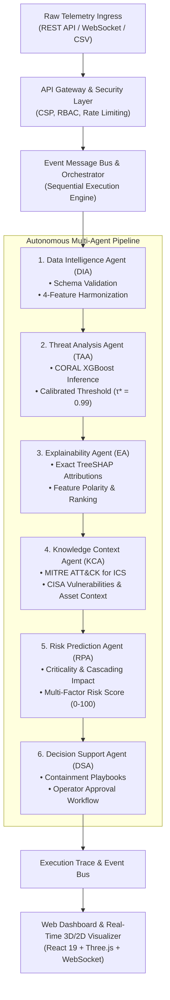
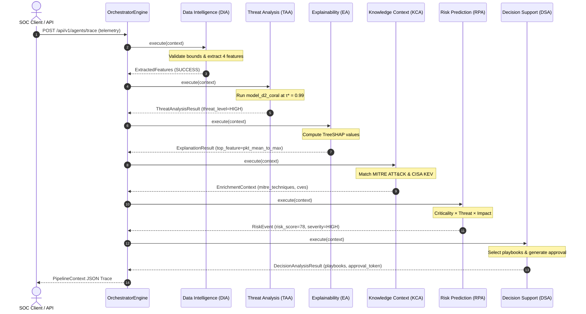

# ARGUS System Architecture (`docs/ARCHITECTURE.md`)

This document provides a technical specification of the ARGUS software architecture. It details the system layers, the sequential multi-agent execution pipeline, inter-agent data contracts, security controls, and failure-handling strategies.

---

## 1. System Design Goals

1. **Autonomous Cyber-Physical Defense**: Protect Industrial Control Systems (ICS), SCADA networks, and Smart Grid infrastructure by executing autonomous, sequential threat analysis and incident response.
2. **Leakage-Controlled ML Inference**: Provide reliable machine learning predictions under severe cross-domain distributional shift using validated domain adaptation models (Class-Aware CORAL + XGBoost).
3. **Rigorous Explainability**: Provide exact, per-sample TreeSHAP attributions to explain classification decisions to Security Operations Center (SOC) analysts before taking defensive action.
4. **OT / ICS Knowledge Grounding**: Correlate anomalies with MITRE ATT&CK for ICS matrices, CISA Known Exploited Vulnerabilities (KEV), and OT protocols (Modbus, DNP3, IEC 60870-5-104).
5. **Human-in-the-Loop Operational Governance**: Calculate multi-factor operational risk scores ($0\text{--}100$) and generate deterministic mitigation playbooks requiring explicit operator authorization for high-impact actions.

---

## 2. Layered Architecture Diagram

---

## 3. The 6-Agent Execution Pipeline

The multi-agent pipeline is orchestrated sequentially. All agents share an immutable state container called `PipelineContext`. Upstream agents append their structured outputs to this context; downstream agents consume typed outputs from upstream agents.

### Agent Specifications

| # | Agent | Input Dependency | Output Produced | Core Algorithms / Tools |
| :---: | :--- | :--- | :--- | :--- |
| **1** | **Data Intelligence Agent (DIA)** | Raw telemetry dictionary | `ExtractedFeatures` | Numerical bounds validation, zero-preservation, 4-feature extraction (`pkt_mean_to_max`, `tcp_flag_density`, `log_pkt_mean`, `log_pkt_max`). |
| **2** | **Threat Analysis Agent (TAA)** | `ExtractedFeatures` | `ThreatAnalysisResult` | `ModelRegistry` model retrieval, XGBoost probability inference, decision thresholding against $\tau^* = 0.99$. |
| **3** | **Explainability Agent (EA)** | `ThreatAnalysisResult` | `ExplanationResult` | TreeExplainer TreeSHAP computation against background distributions, feature contribution ranking. |
| **4** | **Knowledge Context Agent (KCA)** | `ExplanationResult` | `EnrichmentContext` | MITRE ATT&CK for ICS matrix lookup, CISA vulnerability catalog, OT protocol semantics. |
| **5** | **Risk Prediction Agent (RPA)** | `EnrichmentContext`, `ThreatAnalysisResult` | `RiskEvent` | Criticality analysis, grid disruption estimation, deterministic score: $\text{round}(\text{Crit} \times \text{Threat} \times \text{Impact} \times 100)$. |
| **6** | **Decision Support Agent (DSA)** | `RiskEvent` | `DecisionAnalysisResult` | Playbook selector, action prioritization, cryptographically signed approval token generation. |

---

## 4. Model Registry & Feature Representation

The platform manages machine learning models through a centralized `ModelRegistry`:

1. **Harmonized 4-Feature Schema (`ARGUS-4`)**:
   Used for cross-domain transfer between D1 (CICIoT2023) and D2 (NF-ToN-IoT-v2).
   - `pkt_mean_to_max`: Ratio of mean packet size to maximum packet size ($[0, 1]$).
   - `tcp_flag_density`: Ratio of TCP flag occurrences to total packet count ($[0, 1]$).
   - `log_pkt_mean`: Natural log of mean packet size ($\ln(\text{mean} + 1)$).
   - `log_pkt_max`: Natural log of maximum packet size ($\ln(\text{max} + 1)$).

2. **D3 Native 73-Feature Schema (`D3_NATIVE_FEATURES`)**:
   Used for in-domain SCADA network protection (`artifacts/models/model_d3_native.txt`). Enforces exactly **73 features**: 62 standard network flow features + 11 derived statistical features.

3. **Production Model Status Matrix**:
   - `model_d2_coral`: **Production Winner** (Class-Aware CORAL + XGBoost, $\tau^* = 0.99$).
   - `model_d1_baseline`: Production Reference (Unadapted XGBoost source baseline).
   - `model_d3_native`: Production SCADA Baseline (LightGBM 73-feature model).
   - `xgb_source`, `xgb_adapted`: Production Auxiliary models.
   - `model_d2_dann`: **Offline Research Model** (`status="unavailable"`). Available for forensic reproduction in `scripts/p2_1_same_test_comparison.py`, but blocked from production triage due to majority-class collapse ($\text{ROC-AUC} = 0.3321$).

---

## 5. Security & Defensive Controls

ARGUS implements multi-layered security controls designed for critical infrastructure:

- **Content Security Policy (CSP)**: Hardened headers allowing necessary Three.js WebGL workers (`worker-src 'self' blob:`, `child-src 'self' blob:`) while strictly enforcing script and style sandboxing.
- **OWASP HTTP Headers**: Automatic injection of `X-Frame-Options: DENY`, `X-Content-Type-Options: nosniff`, and `Referrer-Policy: strict-origin-when-cross-origin`.
- **Role-Based Access Control (RBAC)**: Fine-grained permissions (`read:agent-topology`, `execute:flow-simulation`, `admin:models`) validated via JWT authentication.
- **Model Tamper Resistance**: All model artifact hashes are verified at application startup against `artifacts/models/INTEGRITY_MANIFEST.json`. If any file is tampered with or corrupted, the server halts immediately.

---

## 6. Fault Tolerance & Resilience

- **Fail-Safe Skip Logic**: If an upstream agent encounters an unhandled exception or malformed input, it logs a structured failure event. All downstream dependent agents are automatically marked with status `SKIPPED`. The system never synthesizes fake predictions.
- **Bounded Input Sanitization**: Telemetry inputs are checked against physical protocol constraints. Non-numeric values, negative packet lengths, and infinite rates are rejected at the `DIA` stage.
